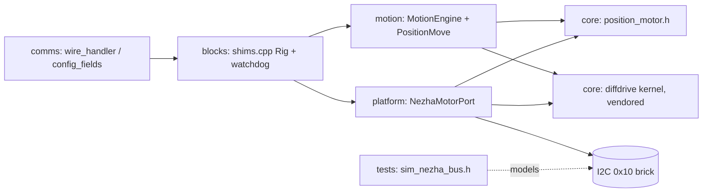

<!-- CLASI: Before changing code or making plans, review the SE process in CLAUDE.md -->

# Sprint 042: Position moves through the motor's own loop, on the host

## Goals

Implement everything in `docs/code-review/2026-10-27/change-plan.md` section 2 (C1 to C12), host-only: position moves run through the motor's own position loop instead of host velocity streaming. No hardware in this sprint.

Decisions taken (change-plan section 0):
- **D1**: the watchdog keeps its invariant (a stalled host still stops the robot); position-mode moves are built around it, not by weakening it.
- **D2**: the fine-velocity actuator (`speed_path`) is built behind a switch, default 0 (off). Its hardware A/B is sprint 043.

Suggested order from the plan: C11 first, then C1 -> C4 -> C2 (-> C3) -> C5 -> C6 -> C7 -> C8, with C9, C10, C12 anywhere.

Ends with:
- a hex that builds;
- the host suite green;
- the sim tour closing with `position_mode 1`;
- the "no 0x60 during a move" regression pinned in a test;
- the brick protocol (opcode) reference in-tree.

## Scope

### In Scope
- C1 to C12 of change-plan.md section 2 (host side only).
- `speed_path` switch, default 0 (host half).
- Every stop path hard-stops a live move; jerk path honours the speed floor; nudge no longer rounds to whole millimetres.
- Brick opcode reference committed in-tree.

### Out of Scope
- Any hardware run, kernel-default changes, scaffolding removal, default flip (all sprint 043).
- Anything marked C13 to C20 in the change plan (sprint 043).

## Issues
- position-moves-through-the-motors-own-position-loop.md
- fine-velocity-actuator-behind-a-speed-path-switch.md (host half)
- every-stop-path-hard-stops-a-live-move.md
- jerk-path-skips-the-speed-floor.md
- nudge-rounds-to-whole-millimetres.md
- nezha-brick-opcode-reference-in-tree.md

## Dependencies
None upstream. Sprint 043 depends on this one.

Sources: `docs/code-review/2026-10-27/change-plan.md`, `docs/code-review/2026-10-27/motor-path-review.md` (section 8).

## Use Cases

- **SUC-001** (position moves): A host-side `WHEELS_X`/`MOVE_X`/`GO_TO`
  straight or pivot at `position_mode 1` runs through the motor's own
  position loop, lands within one quantum (10 counts) of the target, and
  writes no `0x60` frame while it is live.
- **SUC-002** (stops): `STOP`, `ESTOP`, `stop move`, the starvation
  watchdog (D1), `configureWiring()` and the fault handler hard-stop a
  live move with `0x5F`; the fault frame covers M1 to M4.
- **SUC-003** (routing and config): `position_mode` and `speed_path`
  are settable by name and ordinal; velocity verbs (`WHEELS_V`,
  `MOVE_V`, twist, line following) never take the built-in path;
  `STATUS` says which path ran.
- **SUC-004** (fine velocity, off by default): with `speed_path 1`,
  `setDuty()` produces `0x77`/`0x70` mode 3 pairs and a `0x5F` stop;
  with 0 the frame log is byte-identical to today.
- **SUC-005** (small fixes and the in-tree reference): the jerk path
  honours the speed floor, `nudge()` takes hundredths of a millimetre,
  and the brick opcode map plus measured tables are in the repo for the
  simulator and tests to cite.

## Design

Sizing: Substantial. A new core interface (`core/position_motor.h`), a
new engine mode (`PositionMove`), a port implementation, a simulator
extension, two config ordinals, routing and stop paths across core,
motion, platform, comms and blocks, with a new dependency
`motion -> core/position_motor.h` and `platform -> core/position_motor.h`.

The persistent design docs are revised in the sprint's `design/`
overlay (seeded copies of `docs/design/design.md` and the
`core`, `motion`, `platform`, `comms`, `blocks` DESIGN.md files); no
separate Architecture section is written. `src/DESIGN.md` could not be
seeded because the overlay is flat and `tests/DESIGN.md` has the same
basename; ticket 012 edits `src/DESIGN.md` (sections 3 and 7) directly.

Dependency direction is unchanged: engine and port both depend on the
libc-only interface in `core/`; neither depends on the other, and the
kernel does not know the interface exists (it stays byte-identical).
No cycle. Fan-out of `MotionEngine` rises by one (to `PositionMotor`).

Key decision: the kernel stays untouched and a move-live latch in the
port drops staged `setDuty()` writes during a move (review F3), instead
of a new kernel mode. Consequence: the engine must keep stepping the
kernel for encoder reads while staging nothing.

Self-review verdict (consistency, codebase alignment, design quality,
anti-patterns, risks): APPROVE WITH CHANGES. Watch for shotgun surgery
in stop paths (mitigated: ticket 008 routes them through one
`hardStop`-first helper) and for `Output`/`appliedDuty()` consumers that
read 0 during a move (mitigated: `driven()`, ticket 003/005). Open
question for sprint 043, not this one: whether `position_mode 1` becomes
the default.

## Tickets

| # | Title | depends-on |
| --- | --- | --- |
| 001 | Brick protocol reference in-tree (C11) | none |
| 002 | PositionMotor port interface (C1) | 001 |
| 003 | Simulated brick learns the sniffed opcodes (C4) | 001, 002 |
| 004 | NezhaMotorPort position moves and move-live latch (C2) | 002, 003 |
| 005 | speed_path 1 in NezhaMotorPort (C3) | 004 |
| 006 | MotionEngine PositionMove (C5) | 004 |
| 007 | Config ordinals position_mode and speed_path (C6) | 005, 006 |
| 008 | Route verbs and blocks to PositionMove (C7) | 007 |
| 009 | Every stop path hard-stops a live move (C8) | 008 |
| 010 | Jerk path honours the speed floor (C9) | none |
| 011 | nudge in hundredths of a millimetre (C10) | none |
| 012 | Manifest, docs, hex build, design validate (C12) | 001-011 |
