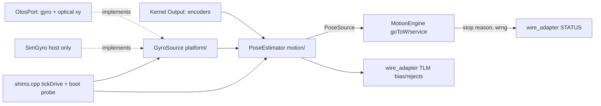

<!-- CLASI: Before changing code or making plans, review the SE process in CLAUDE.md -->

# Sprint 044: Pose estimator with gyro bias tracking and closed-loop legs for OTOS, gyro-only and encoder-only robots

## Goals

1. One pose estimator that works in all three hardware configurations
   (OTOS, gyro-only, encoders-only), replacing `Odometry::fuseHeading()`.
2. Online gyro bias tracking (ZARU at rest, encoder comparison in
   motion) with an idle sensor read path, so heading no longer drifts
   ~50 deg/hour.
3. Fix the GO_TO_W "target behind" wrong-way stall (5% of legs).
4. Close the loop on legs: pivot ends on estimator heading, straight steers
   on estimator pose. Target arrival: median < 1 cm, p90 < 2 cm.

## Problem

The 2026-10-28 camera-truthed 100 m run on vevov
(`captures/vevov-otos-drift-20261028/`) showed fused heading ending
+79 deg off the camera, worse than the raw OTOS (+43 deg) because
`fuseHeading()` permanently re-anchors on rejected samples; the OTOS gyro
has an unestimated ~50 deg/h bias; legs are open-loop after planning
(2.2 cm median / 6.0 cm p90 arrival, nearly all cross-track); 11 of 202
legs stalled on `wrongWay`; and the OTOS is never read while idle.
Full evidence in
`clasi/issues/otos-fusion-drifts-worse-than-the-sensor-and-legs-miss-cross-track.md`.
Most of the fleet has no OTOS, so the solution cannot be OTOS-specific.

## Solution

A host-portable `PoseEstimator` (`motion/pose_estimator.h`) fed by encoders
plus an optional `GyroSource` and optional optical position, selected by a
boot-time probe, with a bias model, graceful degradation, and live TLM.
`goToW()` then consumes the estimator: explicit target-behind policy,
distinct wrong-way reason, pivot closure on estimator heading, straight
steering on world-frame cross-track, short-straight final residual.

## Success Criteria

- Host tests green in all three configurations (OTOS, gyro-only via
  simulated gyro, encoders-only) for estimator, degradation, and leg
  control.
- Replay of `drift1.jsonl` rest samples reproduces the issue's bias
  numbers within stated tolerances.
- Hardware (ticket 009): 100 m random run, no camera re-zero: pose error
  <= 15 cm rms, heading <= 3 deg rms (second half), zero wrong-way
  stalls; arrival median < 1 cm, p90 < 2 cm; stationary 30 min heading
  change < 2 deg after settling; an encoders-only robot passes the
  leg-accuracy and no-stall criteria.

## Scope

### In Scope

- `GyroSource` interface, OTOS adapter, `SimGyro`; boot probe and config.
- `PoseEstimator`, bias tracking, reject handling, dropout degradation.
- Idle sensor read path; TLM `bias`/reject columns; STATUS `wrng` and
  distinct wrong-way reason.
- Target-behind policy; pivot closure; straight steering; final residual.
- Replay host test; hardware acceptance run.

### Out of Scope

- The real driver for the non-OTOS gyro part (part not chosen) -- follow-on
  ticket once chosen.
- Re-running chip `calibrateImu()` after stillness is optional inside
  ticket 004 only if ZARU alone does not meet the stationary criterion.
- Camera as a control input (stays diagnostic only).

## Test Strategy

Host-first: `tests/host` shim for the estimator driven by scripted
encoder Outputs and `SimGyro` (bias, wander, noise, dropout, freeze),
parametrized over the three configurations. Replay test over
`drift1.jsonl`. Engine-level tests (motion_engine shim) for target-behind
and closed-loop legs with `FakePoseSource`/estimator. Hardware acceptance
via `tests/dev/otos_drift.py` and `otos_gyro.py`; any measurement claim
cites its capture file, board and date per
`.claude/rules/measurement-citations.md`.

## Architecture

**Sizing: Substantial** -- new cross-module dependencies (motion ->
platform `GyroSource`, shims -> estimator), a changed sensor doctrine
(OTOS no longer move-boundary-only), TLM schema change, 4+ subsystems
touched. Under the project's design-doc opt-in, the architecture lives in
this sprint's `design/` overlay (`design.md`, `DESIGN.md`,
`motion-DESIGN.md`, `platform-DESIGN.md`), not here.

### Architecture Overview

Dependency direction: platform (`GyroSource` impls) <- shims -> motion;
`PoseEstimator` depends only on the abstract `GyroSource`/optical
interface (defined in a host-portable header), never on `OtosPort`, so
motion stays below platform.

### Design Rationale

- **Estimator on host side of the chip, not chip calibration**: the chip
  cannot know when it is still and has no bias state (issue Research).
- **Position from OTOS x/y when present**: replay showed it is the best
  track (12 cm rms/100 m).
- **Doctrine change**: "OTOS at move boundaries only, never steered in
  flight" (design.md Sensor doctrine) is superseded; recorded in the
  overlay. This follows the stakeholder issue; flagged as Open Question 1.
- **Target-behind = pivot then forward straight** (simple, always
  forward), versus a deliberate reverse straight: chosen for fewer
  code paths on every config; reverse may return later.
- **Split risk**: ~9 tickets with firmware + hardware. Natural split:
  044 = tickets 001-005 (estimator, sensors, TLM) and 006 (stall fix);
  045 = 007-009. Kept as one sprint because 007-008 cannot be validated
  without the estimator; decision for the stakeholder (Open Question 2).

### Migration Concerns

TLM FULL gains columns (golden telemetry fixture, radio-robot-lib/
robot-console parsers must tolerate extra columns -- verify in 005).
`Odometry::fuseHeading()` is removed; callers (shims.cpp) change in 004.

## Use Cases

### SUC-001: Heading holds at rest and in motion without OTOS-specific hardware
Parent: none (new)

- **Actor**: Robot running any program
- **Preconditions**: Robot powered; config = OTOS, gyro-only, or encoders-only
- **Main Flow**:
  1. Boot probe detects sensors.
  2. Estimator tracks bias at rest and while moving.
- **Postconditions**: Heading error stays bounded; sensor loss degrades without a jump.
- **Acceptance Criteria**:
  - [ ] Stationary 30 min: heading change < 2 deg after settling (OTOS and gyro-only)
  - [ ] Sensor dropout mid-run: no heading step > 1 deg at the transition

### SUC-002: Leg to a world point arrives accurately
Parent: none (new)

- **Actor**: Student program calling goToWorld
- **Preconditions**: Any configuration
- **Main Flow**: pivot to heading, steer straight on world cross-track, trim residual.
- **Postconditions**: Arrival median < 1 cm, p90 < 2 cm (sensor configs).
- **Acceptance Criteria**:
  - [ ] Host: leg ends within tolerance in all three configurations
  - [ ] Hardware: criteria in Success Criteria

### SUC-003: Target behind never stalls the leg
Parent: none (new)

- **Actor**: Student program
- **Preconditions**: Target bearing near +-180 deg
- **Main Flow**: explicit pivot-then-straight; no reverse arc.
- **Postconditions**: Leg completes; any wrong-way termination has its own reason and is visible in STATUS.
- **Acceptance Criteria**:
  - [ ] Zero wrong-way stalls in host sweep of bearings and 100 m hardware run

### SUC-004: Operator can see estimator health
Parent: none (new)

- **Actor**: Operator / tooling
- **Main Flow**: read TLM `bias`, rejects, `ox/oy/oh` live at rest.
- **Acceptance Criteria**:
  - [ ] TLM values update while idle

## GitHub Issues

None.

## Definition of Ready

Before tickets can be created, all of the following must be true:

- [ ] Sprint planning document is complete (sprint.md, including its
      Architecture and Use Cases sections)
- [ ] Architecture review passed (or skipped, for changes with no
      architectural impact)
- [ ] Stakeholder has approved the sprint plan

## Tickets

| # | Title | Depends On |
|---|-------|------------|
| 001 | GyroSource interface, SimGyro and sensor-configuration probe | - |
| 002 | PoseEstimator with bias tracking and degradation | 001 |
| 003 | Replay drift1 rest samples through the host estimator | 002 |
| 004 | Wire estimator into the shim with idle sensor read path | 002 |
| 005 | TLM bias and reject columns and STATUS wrng | 004 |
| 006 | GO_TO_W target-behind policy and distinct wrong-way reason | 002 |
| 007 | Pivot closure on estimator heading | 002, 006 |
| 008 | Straight steering on estimator pose and final residual trim | 007 |
| 009 | Hardware acceptance on OTOS and encoder-only robots | 008, 005 |

Tickets execute serially in the order listed.
